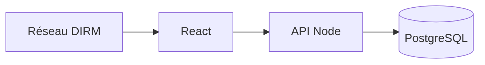

# Lecompas

Application de **gestion des risques** pour la Direction interrégionale de la mer Méditerranée : cartographie, prévention, document unique, amiante, accidents et registre SST.

Les données métier restent sur l'intranet. Ce dépôt contient l'application, pas les dossiers réels.

<p align="center">
  
  
  
  
  
</p>

<p align="center">
  <strong>Dépôt :</strong> <a href="https://github.com/Meriem1403/Lecompas">github.com/Meriem1403/Lecompas</a>
</p>

---

## Sommaire

- [Présentation](#présentation)
- [Fonctionnalités](#fonctionnalités)
- [Stack technique](#stack-technique)
- [Architecture](#architecture)
- [Prérequis](#prérequis)
- [Installation et développement](#installation-et-développement)
- [Variables d'environnement](#variables-denvironnement)
- [Tests](#tests)
- [Déploiement](#déploiement)
- [Sécurité](#sécurité)
- [Structure du projet](#structure-du-projet)
- [Documentation](#documentation)

---

## Présentation

Lecompas est l'outil de pilotage SST de la DIRM. Un gestionnaire évalue un risque, le rattache à un service et à un lieu, suit le plan d'action, puis fait signer le document unique. Les modules amiante, accidentologie et visites médicales couvrent le registre au quotidien.

L'accès est intranet. Le déploiement public Netlify ne sert que le frontend ; la base et l'API restent sur le réseau interne.

---

## Fonctionnalités

| Module | Chemin |
|--------|--------|
| **Tableau de bord** | `/tableau-de-bord` |
| **Évaluation des risques** | `/evaluation-risques` |
| **Référentiel** | `/referentiel-risques` |
| **Plan de prévention** | `/plan-prevention` |
| **Protocoles et fiches** | `/protocoles-securite`, `/fiches-securite` |
| **Plan d'action** | `/plan-action` |
| **Document unique** | `/documents-duerp`, `/signature-duerp` |
| **Amiante** | `/amiante`, attestations et déclarations |
| **Accidents** | `/accidentologie`, `/registre-accidents` |
| **Registre SST** | `/registre-sst` |
| **Visites médicales** | `/visites-medicales` |
| **Arrivées et départs** | `/arrivees-departs` |
| **Administration** | utilisateurs, rôles, services, domaines, lieux |
| **Sensibilisation** | `/sensibilisation-risques` |

---

## Stack technique

| Couche | Technologies |
|--------|----------------|
| Frontend | React, Vite, Tailwind CSS, Radix UI |
| API | Node.js |
| Données | PostgreSQL |
| Tests | Scripts unitaires, Playwright (public et intranet) |
| CI | GitHub Actions, déploiement intranet |
| Conteneurisation | Docker Compose |
| Frontend statique | Netlify (`dist`) |

---

## Architecture



---

## Prérequis

- **Docker** et Docker Compose
- **Node.js** 20 pour les tests lancés hors conteneur
- **Git**

---

## Installation et développement

```bash
git clone https://github.com/Meriem1403/Lecompas.git
cd Lecompas
cp .env.example .env
docker compose up --build
```

Choisir `POSTGRES_PASSWORD` dans `.env` avant le premier lancement. Ne pas réutiliser un mot de passe d'exemple.

Le login de démonstration (`VITE_ALLOW_DEMO_LOGIN`) reste réservé au poste de développement.

---

## Variables d'environnement

| Variable | Rôle |
|----------|------|
| `POSTGRES_DB`, `POSTGRES_USER`, `POSTGRES_PASSWORD` | Base |
| `POSTGRES_HOST_PORT` | Port publié de PostgreSQL |
| `FRONTEND_PORT`, `BACKEND_PORT` | Ports locaux |
| `VITE_API_BASE` | URL de l'API vue par le navigateur |
| `CORS_ORIGINS` | Origines autorisées |
| `PUBLIC_HOST` | Hôte annoncé |
| `VITE_USE_BACKEND_API` | Bascule vers l'API réelle |
| `VITE_ALLOW_DEMO_LOGIN` | Compte de démo, développement seulement |

---

## Tests

```bash
npm run test:unit
npm run test:e2e
npm run test:e2e:intranet
npm run test:integration
npm run test:verify
```

`test:e2e:intranet` vise le parcours derrière l'authentification interne. `test:e2e` couvre le parcours public.

---

## Déploiement

| Cible | Fichier |
|-------|---------|
| Local | `docker-compose.yml` |
| Production Docker | `docker-compose.prod.yml`, `Dockerfile.prod` |
| Intranet | `.github/workflows/deploy-intranet.yml`, dossier `deploy/` |
| Frontend statique | `netlify.toml` (`npm run build`, dossier `dist`) |

Les guides pas à pas sont `doc/DEPLOIEMENT-INTRANET.md` et `doc/PLAN-MISE-EN-PROD.md`.

---

## Sécurité

- Aucun document unique, registre d'accidents ou pièce nominative dans Git. Le dossier `doc/` ne garde que les guides techniques.
- Mot de passe PostgreSQL local, jamais celui d'un environnement réel.
- Signature du document unique documentée dans `SIGNATURE_DUERP_GUIDE.md`.
- CORS limité aux origines listées.

---

## Structure du projet

```
Lecompas/
├── src/app/routes/paths.ts    # Carte des modules
├── backend/                   # API
├── e2e/                       # Playwright
├── tests/                     # Tests unitaires et d'intégration
├── supabase/                  # Schéma alternatif
├── deploy/                    # Intranet
├── doc/                       # Guides de mise en production
└── docker-compose.yml
```

---

## Documentation

| Document | Contenu |
|----------|---------|
| [doc/DEPLOIEMENT-INTRANET.md](./doc/DEPLOIEMENT-INTRANET.md) | Mise en ligne intranet |
| [doc/PLAN-MISE-EN-PROD.md](./doc/PLAN-MISE-EN-PROD.md) | Plan de production |
| [GESTION_RISQUES_ADMIN.md](./GESTION_RISQUES_ADMIN.md) | Administration des risques |
| [SIGNATURE_DUERP_GUIDE.md](./SIGNATURE_DUERP_GUIDE.md) | Signature du document unique |
| [LOGIN_PAGE_GUIDE.md](./LOGIN_PAGE_GUIDE.md) | Page de connexion |

---

<p align="center">
  <sub>DIRM Méditerranée — gestion des risques. Les dossiers SST ne sont pas dans ce dépôt.</sub>
</p>
